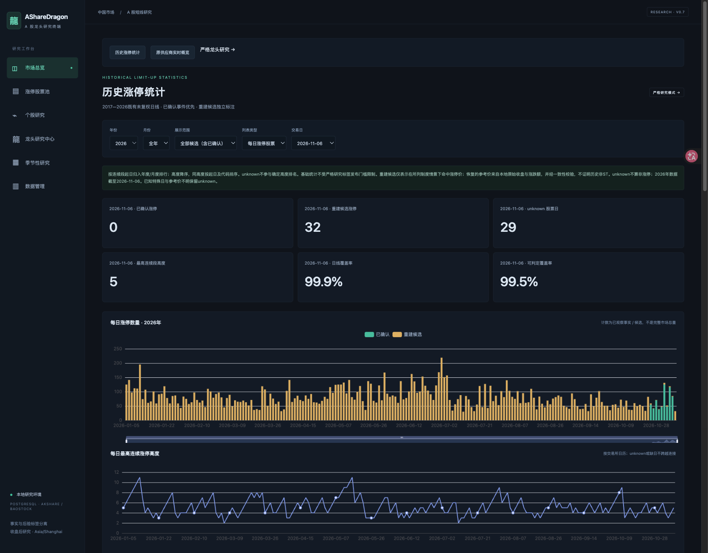

# AShareDragon

A local-first research workspace for historical A-share limit-up events, consecutive limit-up streaks, and dragon-stock analysis. Built with FastAPI, PostgreSQL, DuckDB/Parquet, and Next.js.

**Confirmed events and rule-reconstructed candidates are different evidence classes. Seasonality has not been rigorously established. This project does not execute trades or guarantee returns.**



*Actual homepage showing aggregate historical limit-up counts, evidence categories, coverage and observed streak-height trends. Stock-level records and raw market data are not included in the screenshot.*

## What is implemented

- **Historical limit-up dashboard** (`/`, `/pool`): daily lists, count trends, maximum observed streak height, year/month filters, confirmed-only filtering, unknown counts and coverage indicators.
- **Calendar-aware streaks**: stock/date deduplication, no bridging of missing or unknown sessions, start/end boundaries and lower-bound heights for incomplete segments.
- **IPO classification**: separate IPO-initial, non-IPO and unresolved origins; historical listing regimes; one-price OHLC morphology and traded-range candidates. A traded-range candidate is not proof of execution feasibility.
- **Dragon research center** (`/dragons`): historical rankings, IPO filters, evidence quality, independent historical ST attributes, and non-IPO launch-month research. Clicking a month filters stocks; stock links open the corresponding historical candles.
- **Seasonality and feature studies**: annual threshold counts, trusted-start month distributions, exploratory first-board features, missingness and sensitivity analyses. Strict evidence views remain separate from basic historical statistics.
- **Data operations** (`/data`): collection job management, source provenance, coverage and audit tooling. Collection is explicit; do not launch collectors without the appropriate data rights and credentials.

The locally audited snapshot spans 2017–2026 (through 2026-11-06), with 10,343,963 unadjusted daily rows and 117,611 unique observation segments. These are **local snapshot counts**, not a downloadable dataset or proof that every historical limit-up was independently verified. The non-IPO ≥5-board study contains 1,740 observation segments; only 1,633 have a locatable launch boundary for monthly analysis.

## Architecture

```text
Authorized local/provider observations
        ├── PostgreSQL: operational records, provenance and job queues
        └── local Parquet + DuckDB: versioned research snapshots
                         ↓
              FastAPI read/query services
                         ↓
       Next.js + React + TypeScript + ECharts
```

Source adapters, normalization, analytics, research queries and UI are separate modules. Derived statistics retain evidence classes (`confirmed`, `reconstructed_candidate`, `unknown`) and do not overwrite original observations. Research snapshots and provider archives stay outside Git.

## Evidence and limitations

- Independently supported positive events take precedence over reconstruction. Reconstruction uses historical board rules and trusted references, and remains a candidate classification.
- Unknown is not a failed outcome or zero market activity. Coverage, IPO origin, historical ST status, boundary completeness and tradability are independent attributes.
- Unknown boundaries produce observed minimum heights, not invented final heights. Unique observation-segment keys do not prove that segments separated by unknown dates are independent economic cycles.
- The initial IPO sequence is not directly comparable with an ordinary post-listing streak. IPO-origin unknown is excluded from the non-IPO research main sample.
- Monthly launch distributions use locatable first-board dates, not peak-price months. Uneven annual coverage, sparse independent evidence, repeated stocks, corporate actions and selection bias limit interpretation.
- Feature availability is incomplete. Missing historical capitalisation, order-book, announcement-time or execution information is not filled with present-day values.
- No automated trading, return guarantee, validated predictive model, or claim of formally established seasonality is provided.

Adapters include AKShare and BaoStock, optional Tushare-compatible access, and tools for locally licensed historical files. Provider access is not redistribution permission. Optional US-market context research is also documented separately. **No third-party dataset, purchased archive, credentials, database or raw API response is bundled.**

## Local setup

Prerequisites: Python 3.12+, Node.js compatible with Next.js 16 (the local validation used Node 24), and PostgreSQL 16 or a compatible installation. Commands below run from the project root.

```bash
python3.12 -m venv .venv
.venv/bin/pip install -r backend/requirements.lock.txt
.venv/bin/pip install --no-deps -e backend
npm ci --prefix frontend
cp .env.example .env
createdb asharedragon  # once, after starting PostgreSQL
.venv/bin/alembic -c backend/alembic.ini upgrade head
```

Set `DATABASE_URL` in the ignored `.env` for your local PostgreSQL instance. The example uses localhost without a password; configure credentials privately if required. Optional provider credentials default to empty. Never commit `.env` or put credentials in URLs or screenshots.

Start the API and frontend in separate terminals:

```bash
.venv/bin/uvicorn app.main:app --host 127.0.0.1 --port 8000
npm run dev --prefix frontend
```

Visit <http://127.0.0.1:3000> and API documentation at <http://127.0.0.1:8000/docs>. For a production frontend, run `npm run build --prefix frontend`, then `npm run start --prefix frontend`.

The frontend defaults to `http://127.0.0.1:8000`. To change it, set `NEXT_PUBLIC_API_URL` in `frontend/.env.local` before building; configure matching backend `CORS_ORIGINS` in the root `.env`. Next.js does not automatically read the parent `.env`.

The optional `./scripts/dev.sh` also starts the collection worker; the separate commands above do not. Only run `.venv/bin/python -m app.worker` when you intend to process queued collection jobs.

### Research data is not included

A fresh clone provides software, not populated research screens. Existing snapshot readers expect locally provisioned, authorized artifacts under `~/Datasets/asharedragon/`, including the unified research and historical-statistics manifests. Standalone plotting/report scripts may additionally require Matplotlib. Some research routes require their matching parent snapshots and return unavailable/empty states without them. The setup commands do not reconstruct the private reference dataset or download missing data.

Use the [documentation index](docs/README.md) for schema, snapshot construction order and study-specific reproduction instructions. Historical scripts may assume the original local folder layout and access rights. Do not substitute fabricated data for unavailable evidence.

## Validation

```bash
PYTHONPATH=backend .venv/bin/python -m pytest backend/tests scripts -q --disable-warnings
npm run typecheck --prefix frontend
npm run build --prefix frontend
```

PostgreSQL tests use isolated temporary schemas. Snapshot-dependent integration tests require authorized local artifacts; some skip when artifacts are absent, and older historical validation scripts assume local inputs. A successful fresh-clone installation is not equivalent to reproducing the local research results.

See [release validation](docs/release_validation.md) for the actual test environment, results, security review and release boundary.

## Documentation

Start with the [documentation index](docs/README.md), [architecture](docs/architecture.md), [data dictionary](docs/data_dictionary.md), [limit-rule sources](docs/historical_limit_rule_sources.md), [streak classification](docs/dragon_streak_classification.md), and [non-IPO study](docs/non_ipo_dragon_study.md).

Historical reports are retained as dated research records. Their counts and acceptance criteria belong to their stated snapshots; they are not all the current product state. Links labelled **local-only artifact** refer to excluded generated evidence, not files distributed by this repository.

## Research-use disclaimer

This is research software, not investment advice. Historical patterns and exploratory comparisons do not establish a tradable edge, future returns, or execution feasibility. You are responsible for data licences, provider terms and your own decisions. The public repository distributes implementation and methodological summaries; it does not grant rights to third-party market data.
